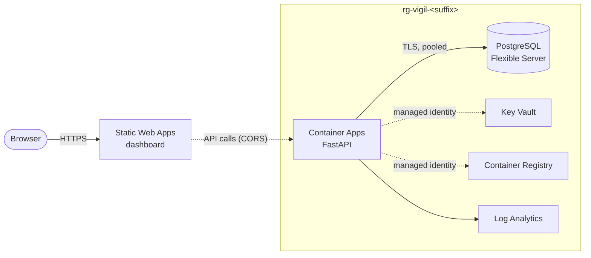

# Deployment

Vigil runs on Microsoft Azure. Terraform defines every resource, and two PowerShell scripts drive it:

```powershell
.\deploy.ps1     # build and deploy everything, then print the URLs and login
.\destroy.ps1    # delete every Azure resource it created
```

## Azure resources used

**Main services**

| # | Azure service | Resource (current deployment) | Region | Size / tier | Role in Vigil |
|---|---|---|---|---|---|
| 1 | **Azure Static Web Apps** | `swa-vigil-q6oes` | East Asia | Free | Hosts the React dashboard on a global CDN with HTTPS |
| 2 | **Azure Container Apps** | `vigil-api` | Korea Central | Consumption, 0.5 vCPU / 1 GiB, 0–1 replica | Runs the FastAPI backend: login, scores, two-step revoke, raw data |
| 3 | **Azure Database for PostgreSQL** Flexible Server | `psql-vigil-q6oes-eastasia`, database `vigil` | East Asia | Burstable B1ms, 32 GB, PostgreSQL 16, 7-day backups | Stores identities, accounts, privileges, audit events, risk scores, revocations and dashboard users |
| 4 | **Azure Key Vault** | `kv-vigil-q6oes` | Korea Central | Standard | Holds the database connection string, the admin password and the login-signing key |

**Supporting resources**

| # | Azure service | Resource | Role |
|---|---|---|---|
| 5 | Resource group | `rg-vigil-q6oes` | Holds every resource below, so teardown is one step |
| 6 | Container Apps environment | `cae-vigil-q6oes-wp` | The network and runtime the API runs in (WorkloadProfiles mode, Consumption profile) |
| 7 | Azure Container Registry | `acrvigilq6oes` (Basic) | Stores the API's Docker image. Admin login is off. |
| 8 | User-assigned managed identity | `id-vigil-q6oes` | The API's identity: pulls the image (`AcrPull`) and reads Key Vault secrets, with no passwords |
| 9 | Log Analytics workspace | `log-vigil-q6oes` | Collects the API's logs (30-day retention) |

The `q6oes` suffix is random per deployment. A fresh deploy after `destroy.ps1` gets a new one.

**Live URLs**

- Dashboard: https://polite-tree-03bc41200.3.azurestaticapps.net
- API: https://vigil-api.orangesand-805e647a.koreacentral.azurecontainerapps.io (docs at `/docs`)

## How it fits together



- **First start:** the API finds the database empty, creates the tables and loads `data/` (about 3 seconds). Later starts skip this, because the data persists.
- **Security:**
  - The database accepts TLS connections only, and its firewall admits Azure services only.
  - Secrets live in Key Vault and are read with the managed identity.
  - The API accepts browser calls only from the dashboard's origin.
  - The registry has no admin password.
- **Performance:** the API keeps a pool of up to 8 database connections and reuses them.

## Deploy

**Needs:** Azure CLI (`az login`), Terraform 1.6+, Node.js 18+, and Docker Desktop (started by the script if needed).
You also need Owner rights on the subscription, because the script creates the `AcrPull` role assignment.

`deploy.ps1` runs six steps:

1. Checks tools, login and the PC clock, and registers the Azure resource providers.
2. Creates the resource group, registry and identity (Terraform, first pass).
3. Builds the API image with Docker and pushes it to the registry.
4. Creates PostgreSQL, Key Vault, Container Apps and the Static Web App (Terraform, second pass). PostgreSQL takes 5–10 minutes.
5. Waits for the API to be healthy. It loads the data on its first start.
6. Builds the dashboard with the API's URL and uploads it to Static Web Apps.

Running it again redeploys the latest code and keeps the data. Options are remembered in
`terraform/deploy.auto.tfvars.json`:

| Option | Default | Purpose |
|---|---|---|
| `-Location` | `koreacentral` | Region for most resources |
| `-DatabaseLocation` | same as `-Location` | Region for PostgreSQL only (this deployment uses `eastasia`) |
| `-MinReplicas` | `0` | `0` scales the API to zero when idle; `1` keeps it warm |
| `-AdminPassword` | random | Super admin password, kept across redeploys |
| `-Build` | `Auto` | `Auto` uses Docker if present, `Local` / `Cloud` forces one |

Get the login again with `terraform -chdir=terraform output -raw admin_password`.

## Tear down

```powershell
.\destroy.ps1           # asks you to type 'yes'
.\destroy.ps1 -Force    # no prompt
```

It runs `terraform destroy` for every resource above, purges the Key Vault, and confirms that the resource group is gone.

## Azure for Students notes

This subscription has limits that only show up when a resource is created:

- **Only five regions are allowed:** koreacentral, malaysiawest, eastasia, uaenorth and indonesiacentral.
- **PostgreSQL B1ms can't be created in Korea Central** (`SkuNotAvailable`), so the database runs in East Asia.
- **Cloud image builds (ACR Tasks) are blocked,** so the image is built with local Docker.
- **Container Apps environments now default to "Express" mode,** which has fewer features. Terraform creates a WorkloadProfiles environment through the `azapi` provider instead.
- **The PC clock must be correct.** Some Azure calls are signed with local time, and the script warns if the clock is off.

## Terraform files

| File | Resources |
|---|---|
| `terraform/main.tf` | Resource group, names, generated secrets, Container Registry, managed identity, Log Analytics |
| `terraform/database.tf` | PostgreSQL server, `vigil` database, firewall rule |
| `terraform/keyvault.tf` | Key Vault, access policies, three secrets |
| `terraform/api.tf` | Container Apps environment and the API app |
| `terraform/frontend.tf` | Static Web App |
| `variables.tf`, `outputs.tf`, `versions.tf` | Inputs, outputs (URLs and names), providers (`azurerm`, `azapi`, `random`) |

**Rough cost while running:** about US$13–20 a month, mostly PostgreSQL. The registry is about US$5,
and Static Web Apps (Free), Key Vault and the scaled-to-zero API cost close to nothing.
Run `.\destroy.ps1` when you are done.
