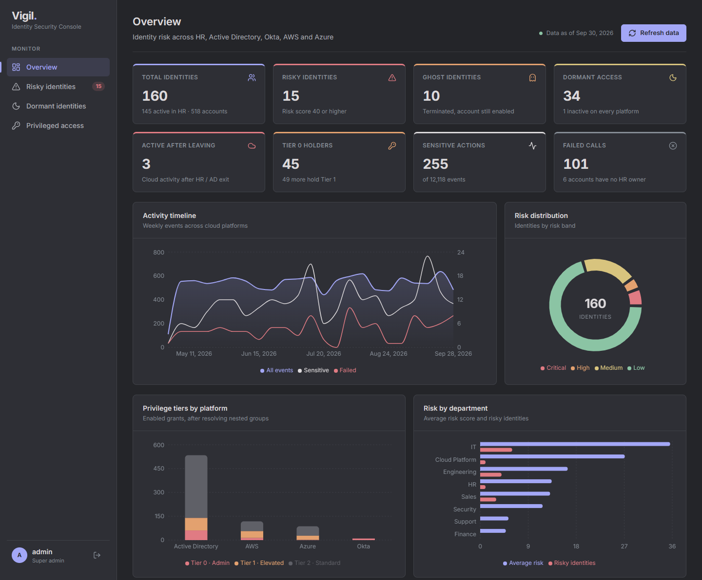
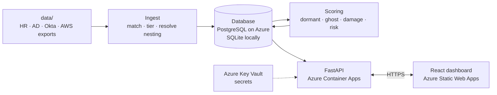

# Vigil

**Vigil is an identity security console.** It joins HR, Active Directory, Okta, AWS and Azure into one
view of who has access to what. It flags the identities that are a risk (ghost accounts, dormant access,
hidden admin rights), and lets a super admin revoke that access from the dashboard.



## Architecture



1. **Ingest** links every account to an HR person by email, falling back to employee ID for admin accounts. It also walks nested AD groups, including circular ones, to find inherited rights.
2. **Scoring** computes the metrics below for every identity.
3. **The API** serves them to a dashboard that only super admins can open.

## How the scores work

All rules live in [`backend/metrics.py`](backend/metrics.py) and [`backend/ingest_data.py`](backend/ingest_data.py).
"Now" is the latest activity in the data: 30 Sep 2026 for the sample set.

### Privilege tiers

| Tier | Meaning | Matched by name (or the source system's own tier) |
|---|---|---|
| **0** | Admin: can take over the domain or cloud | `admin`, `owner`, `super`, `dcsync`, `domain controllers`, `schema`, `enterprise` |
| **1** | Elevated | `operator`, `poweruser`, `contributor`, `prod-access`, `helpdesk`, `escalation`, `it-operations` … |
| **2** | Normal user | everything else |

### Damage score (0–100): what the identity *could* break

```
damage = min(100, Σ weight(tier) for each distinct privilege on an enabled account)
         weight: Tier 0 = 25, Tier 1 = 10, Tier 2 = 0
         × 0.5 if the scope is non-production (dev, staging, test, sandbox)
```

### Risk score (0–100): how likely the identity is to be misused

```
risk = min(100, Σ signal points + round(0.3 × damage))
```

| Signal | Points | Fires when |
|---|---|---|
| Ghost account | **40** | Terminated in HR, but an account is still enabled |
| Activity after termination | **30** | Any sign-in or event after the termination date |
| No MFA | **20** | Enabled Okta account with no MFA factor |
| Active while on leave | **15** | Signed in after the leave start date |
| Dormant account | **10** | See *Dormant* below |
| SMS-only MFA | **10** | Okta MFA is SMS only |
| Repeated access denied | **10** | 3 or more failed calls in the last 30 days |
| Sensitive actions | **10** | Any sensitive AWS call in the last 30 days (e.g. `CreateAccessKey`, `AttachRolePolicy`, `StopLogging`, `DeleteTrail`) |
| Suspended, not deprovisioned | **5** | A terminated user's Okta account is only suspended |
| Disabled account keeps privilege | **5** | A disabled account still holds Tier 0/1 rights |

### Thresholds

| Rule | Value |
|---|---|
| **Risky** | risk ≥ **40** |
| Risk bands | Critical ≥ 70 · High ≥ 40 · Medium ≥ 20 · Low < 20 |
| **Dormant** (score signal) | HR Active, with an AD or Okta account unused for **90+ days** (or never used) |
| **Dormant access** (dashboard list) | an enabled account unused for **30+ days** by default. Filter: All / 30 / 60 / 90 / 180 days |
| **Ghost** | HR Terminated, with any account still enabled |
| **Active after leaving** | Terminated, on leave, or no enabled AD account, yet AWS or Azure recorded activity afterwards |
| "Recent" window | last **30 days** |

**Worked example.** EMP-1057 was terminated, but their AD account `rrodriguez` was still enabled with
DnsAdmins (Tier 0) and two Tier 1 groups.

- Damage = 25 + 10 + 10 = **45**
- Risk = ghost 40 + activity after termination 30 + suspended 5 + round(0.3 × 45) = **89**, which is critical
- After revoking the account, ghost and damage drop to 0, so risk = 30 + 5 = **35**, which is not risky.

## Revoking access (two-step verification)

The risky, dormant and privileged pages each have a **Revoke** button:

1. **Choose access.** Pick the accounts and give a reason. The server checks the selection and issues a confirmation that expires in **5 minutes**.
2. **Verify it's you.** Re-enter your password and type the employee ID.

The accounts are then disabled and their privileges removed. The scores are recomputed and the action is
written to an audit log (who, when, why, which privileges). Revocations are re-applied after every data
refresh. Vigil works on exported data, so make the same change in the source system too.

## Other features

- **Raw data page:** every export file, searchable and paged, with the full original record on click, plus the revocation log.
- **Login security:** PBKDF2 password hashing (200,000 iterations), lockout after 5 failed attempts for 5 minutes, and signed sessions that last 8 hours.

## Run locally

Needs only Docker. One command starts the same three tiers as on Azure: PostgreSQL, the API, and the dashboard (served by nginx).

```bash
docker compose up --build      # start, then open http://localhost:8001
docker compose down            # stop (add -v to also delete the local database)
```

Sign in with `superadmin` / `Vigil@Demo2026`. This is a public demo login for the sample data.
Set `VIGIL_ADMIN_PASSWORD` before the first start to choose your own, and `VIGIL_PORT` to use another port.

<sub>Without Docker, `pip install -r requirements.txt` then `python run.py` runs everything on SQLite.</sub>

## Deploy to Azure

```powershell
.\deploy.ps1     # builds and deploys everything with Terraform, prints the URLs and login
.\destroy.ps1    # deletes every Azure resource it created
```

| Tier | Azure service |
|---|---|
| Dashboard | Azure Static Web Apps |
| API | Azure Container Apps |
| Database | Azure Database for PostgreSQL Flexible Server |
| Secrets | Azure Key Vault |
| Supporting | Container Registry, managed identity, Log Analytics |

Needs the Azure CLI, Terraform, Node.js and Docker.

**Every Azure resource used, how they connect, and how to deploy: [DEPLOYMENT.md](DEPLOYMENT.md)**

## Sample data

`data/` holds a synthetic company: **160 employees**, **173 AD accounts** in 71 nested groups, Okta users
with MFA and AWS/Azure assignments, and **12,118 AWS CloudTrail events** (May–Sep 2026).

## Project structure

```text
backend/     ingest_data · insert_data · metrics · queries · revocation · raw_data · auth · expose_backend (FastAPI)
frontend/    React + Vite dashboard
terraform/   Azure infrastructure, one file per service
data/        synthetic exports
docker-compose.yml   local one-command start · deploy.ps1 / destroy.ps1   Azure one-command deploy and teardown
```

[github.com/Jairamhegde/Vigil](https://github.com/Jairamhegde/Vigil)
