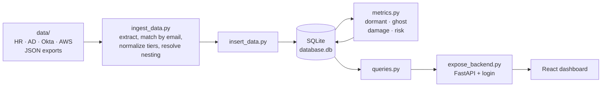
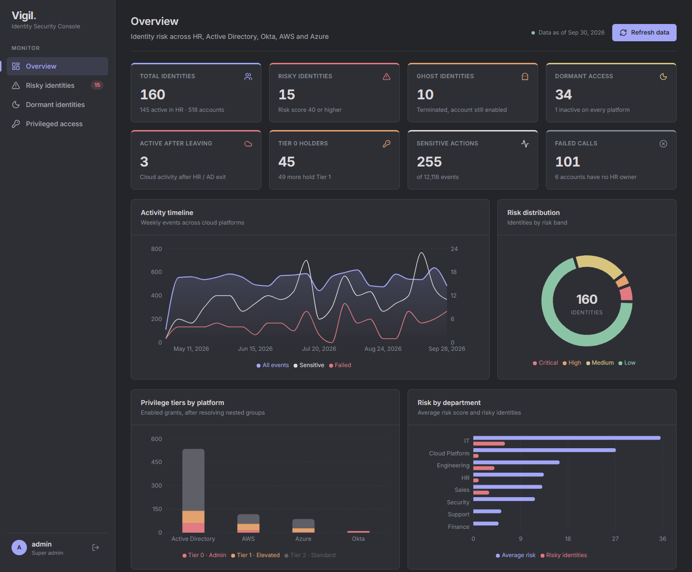
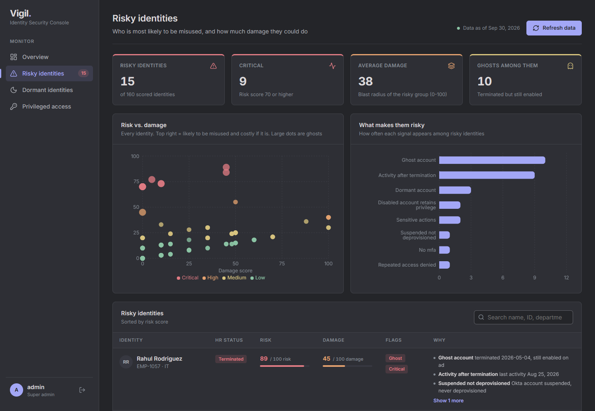

# Vigil

**An identity security console that shows who has access to what across HR, Active Directory, Okta, AWS and Azure, and which of those identities are a risk.**

## The problem

People join, move and leave, but their accounts don't always follow. Every company ends up with:

- **Ghost accounts.** Someone has left, but their login still works.
- **Dormant access.** Accounts nobody has used in months, still open to attackers.
- **Hidden admin rights.** Admin access inherited through nested groups that nobody notices.

Each system only sees its own accounts, so no single team sees the whole picture.

## What Vigil does

- **Matches every account to a real person.** AD, Okta, AWS and Azure accounts are linked to the HR record by email. Admin accounts without a mailbox fall back to employee ID.
- **Resolves nested permissions.** AD groups inside groups (even circular ones) are walked to find every inherited right, along with the group it came through.
- **Ranks privilege on one scale.** Tier 0 is any admin, tier 1 is elevated, tier 2 is a normal user.
- **Scores every identity:**
  - **Ghost:** terminated in HR but an account is still enabled
  - **Dormant:** an account unused for 30+ days, or never used
  - **Damage score:** how much harm the identity could do with its access
  - **Risk score:** risk signals (no MFA, activity after leaving, sensitive actions...) combined with damage
- **Shows it all in one dashboard** that only super admins can open.

## Architecture



Each part only talks to the next one. The extractor never touches the database, and the dashboard only talks to the API over HTTP.

For the full explanation (matching logic, schema, nested groups and every scoring formula with worked examples), see **[DETAIL.md](DETAIL.md)**.

## Screenshots

**Overview**



**Risky identities**



## Data

The `data/` folder holds a synthetic company: 160 employees, as of 30 Sep 2026.

| File | Contents |
|---|---|
| `identities (2).json` | HR records: name, email, department, title, status (Active / On Leave / Terminated) and manager. The single source of truth. |
| `ad_directory.json` | Active Directory: 173 accounts (employee, `adm-*` admin and `svc-*` service), 71 groups with nesting, and OUs. |
| `okta_identities.json` | Okta: users, groups, MFA factors, admin roles, and the AWS / Azure access granted through Okta apps. |
| `aws_cloudtrail_logs.json` | AWS CloudTrail: 12,118 events from May to September 2026. |

Okta System Log (`okta_system_log.json`) and Azure activity log (`azure_activity_logs.json`) files are picked up automatically if you add them.

## How to run

You need **Python 3.10+** and **Node.js 18+**. Node is only used to build the dashboard on the first run.

```bash
pip install -r requirements.txt
python run.py
```

Open **http://localhost:8001** and sign in:

| | |
|---|---|
| **Username** | `superadmin` |
| **Password** | `Vigil@Demo2026` |

> **This is a public demo login for the synthetic data.** Vigil only listens on `localhost`, but change the password before using it with real data:
>
> ```bash
> python -m backend.auth create-user superadmin super_admin
> ```

`run.py` loads the data, computes the scores, builds the dashboard (only when it changed) and starts the server.

**Choosing your own first login.** To create a different super admin instead of the demo one, set these before the very first run:

```bash
VIGIL_ADMIN_USER=admin VIGIL_ADMIN_PASSWORD="choose-a-strong-one" python run.py
```

Add or reset users at any time:

```bash
python -m backend.auth create-user <username> super_admin    # or: viewer (cannot see the dashboard)
```

**Other settings**

| Variable | Default | Purpose |
|---|---|---|
| `VIGIL_PORT` | `8001` | Port to serve on |
| `VIGIL_AUTH_SECRET` | random, stored in `backend/auth.db` | Key used to sign login sessions |
| `VIGIL_CORS_ORIGINS` | none | Extra origins allowed to call the API |

**Developing the dashboard** with hot reload:

```bash
python -m uvicorn backend.expose_backend:app --port 8001   # terminal 1
cd frontend && npm run dev                                 # terminal 2, opens http://localhost:5174
```

## Project structure

```text
run.py              one command: load, score, build, serve
backend/
  ingest_data.py    read the JSON files, match accounts, normalize tiers, resolve nesting
  insert_data.py    load into SQLite (safe to re-run)
  table_creation.py database schema
  metrics.py        dormant / ghost / damage / risk scoring
  queries.py        dashboard queries
  expose_backend.py FastAPI app
  auth.py           users, password hashing, signed sessions
data/               synthetic HR, AD, Okta and AWS exports
frontend/           React + Vite + Recharts dashboard
docs/screenshots/   images used in this README
```

## Repository

[github.com/Jairamhegde/HybridGuard](https://github.com/Jairamhegde/HybridGuard)
